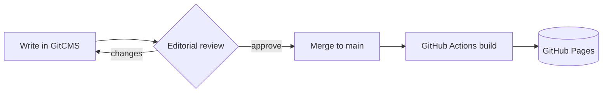
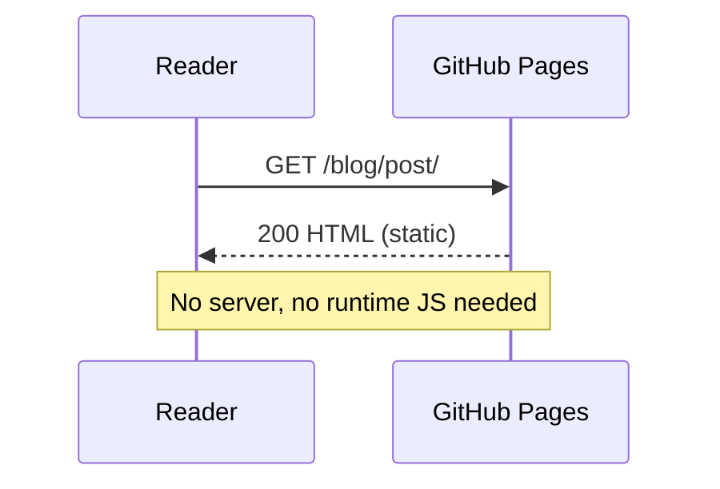

This draft exercises every element. It only renders in `npm run dev`. Check it after any styling change.

## Text

Body text with **bold**, _italic_, ~~strikethrough~~, `inline code`, a [link](https://astro.build) and a footnote.[^1]

> A plain blockquote for quoted material.

- Unordered item
- Another item
  - Nested item

1. Ordered item
2. Second item

- [x] Task done
- [ ] Task to do

## Callouts

> [!NOTE]
> Useful information readers should know, even when skimming.

> [!TIP]
> A helpful suggestion. Callouts can contain `code` and [links](#callouts).

> [!IMPORTANT]
> Key information readers need to achieve their goal.

> [!WARNING] Custom title
> Urgent info that needs immediate attention to avoid problems.

> [!CAUTION]-
> Collapsed by default (`-`). Advises about risks or negative outcomes.

## Code

A titled file with highlighted lines and words:

```js title="src/utils/greet.js" {2} "name"
export function greet(name) {
  const message = `Hello, ${name}!`;
  return message;
}
```

Diff, with line numbers:

```diff lang="css" showLineNumbers
 .button {
-  color: #1f5fbf;
+  color: var(--color-link);
   padding: 0.5rem 1rem;
 }
```

Inserted and deleted line markers on a normal language:

```ts ins={3} del={2}
const tokens = {
  primary: '#1f5fbf',
  primary: 'var(--blue-600)',
};
```

Collapsed sections for boilerplate:

```html collapse={1-4}
<!doctype html>
<html lang="en">
<head>
  <meta charset="utf-8" />
  <title>Collapsed head</title>
</head>
</html>
```

## Terminal

Shell languages get a terminal frame automatically. Leave out `$` prompts so the copy button copies runnable commands:

```bash
npm create astro@latest
cd my-blog && npm run dev
```

With a title:

```sh title="Deploy"
git push origin main
```

Command output (plain text, no syntax colours):

```text title="Output"
✔ Build complete in 1.2s
! 2 warnings
```

## Diagrams





## File tree

```tree title="Project structure"
.gitcms/              # GitCMS config
public/
  CNAME
src/
  assets/images/
  components/
    Header.astro
    **Icon.astro**    # build-time Lucide icons
  content/
    blog/
      post.md
    snippets/
  pages/
    index.astro
    ...
astro.config.mjs
package.json
```

The same tree pasted from the `tree` command:

```tree
src
├── layouts
│   └── BaseLayout.astro
└── styles
    ├── tokens.css
    └── global.css
```

## Images

Image from the GitCMS media library, with a caption from the title:


## Maths

Inline maths $E = mc^2$ and a block:

$$
\text{contrast} = \frac{L_1 + 0.05}{L_2 + 0.05}
$$

## Table

| Token          | Light     | Dark      |
| -------------- | --------- | --------- |
| `--color-bg`   | `#fcfcfb` | `#0e0f11` |
| `--color-link` | `#1f5fbf` | `#8ab4f8` |

[^1]: Footnotes render at the end of the post.
